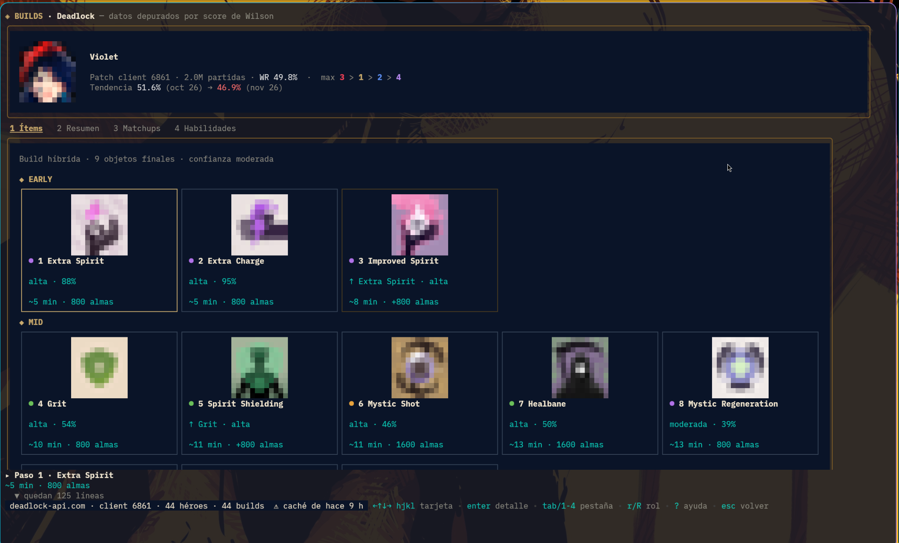
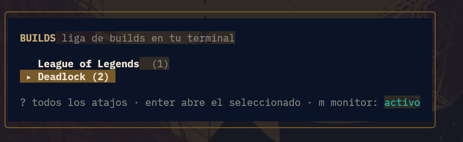
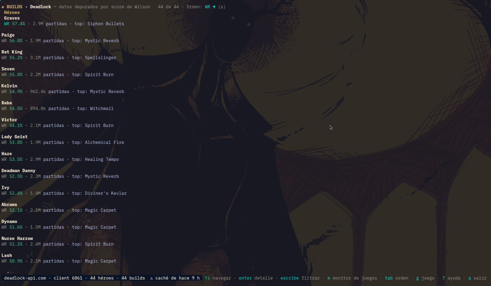

# MOBA TUI

```text
 __  __  ___  ____    _    _____ _   _ ___
|  \/  |/ _ \| __ )  / \  |_   _| | | |_ _|
| |\/| | | | |  _ \ / _ \   | | | | | || |
| |  | | |_| | |_) / ___ \  | | | |_| || |
|_|  |_|\___/|____/_/   \_\ |_|  \___/|___|
```

**League of Legends and Deadlock builds, runes, and stats — right in your terminal.**

[README en español](README.md)

A fast terminal UI (TUI) for **League of Legends** and **Deadlock** that turns real match data into builds, skill orders, and stats you can read at a glance while you play.

Built in Go with [Bubble Tea](https://github.com/charmbracelet/bubbletea) and [Lip Gloss](https://github.com/charmbracelet/lipgloss).

---

## Screenshots

### Build and items view (Deadlock)
> Truecolor cards by phase (`EARLY`, `MID`, `LATE`), component upgrades (`↑`), estimated timing, soul cost, skill max order (`max 3 > 1 > 2 > 4`), and win-rate trends across patches.



### Game selector and hero list

| Main menu and active monitor | Filterable list ranked by Wilson lower bound |
| --- | --- |
|  |  |

---

## Key features

- **Real data, no guesswork:** Builds generated from real purchase sequences and conservative statistical evaluation.
- **Visible confidence:** *High / moderate / low* labels based on sample size and uncertainty — never presented as a “win probability”.
- **Truecolor terminal art:** Item icons and hero/champion portraits rendered directly in the console.
- **Works offline:** On-disk cache with TTL, controlled stale-if-error degradation, and fallback to bundled fixtures.
- **Identifiable:** `mobatui --version` reports version, commit, Go and platform. On startup it notifies when a newer GitHub release exists (non-blocking, no self-update); disable with `-no-update-check` or `-offline`.
- **Match monitor (`m`):** Automatically detects when the game is running and, in League of Legends, identifies your active champion in real time via the *Live Client Data API*.

### Deadlock (via [deadlock-api.com](https://deadlock-api.com))
- **Hybrid build generator:** Combines per-item statistics with a progression engine that respects upgrade chains, component consumption, and inventory limits.
- **Phases and context:** Routes split into **EARLY / MID / LATE**, long-game extensions, and **situational** items grouped by purpose (anti-heal, physical/spirit defense, CC resistance, survivability, and extra damage).
- **Real abilities:** Skill-up order mapped to the hero’s actual keys (`signature1..4`), consolidating transformed forms into their 4 real slots.
- **Meta and matchups:** Win-rate trends across patches, matchups, and synergies.

### League of Legends (via [lolalytics.com](https://lolalytics.com))
- **Everything in one place:** Item builds, rune pages, skill orders, and summoner spells.
- **Wilson lower-bound ranking:** Prevents small samples with inflated win rates from outranking builds proven over tens of thousands of games.

---

## Requirements and installation

- **Go 1.27** or newer to build from source.
- A **Truecolor-capable terminal** (Kitty, Alacritty, WezTerm, Ghostty, Windows Terminal, iTerm2, etc.) to render icons and portraits correctly.
- **Platforms:** Linux is the primary platform; macOS and Windows are supported in code and CI.

```bash
go install github.com/Eion21/mobatui@latest
mobatui
```

Or build from the repository:

```bash
git clone https://github.com/Eion21/mobatui
cd mobatui
go build -o mobatui .
./mobatui
```

Cache is stored in the user cache directory (defaults to `~/.cache/mobatui` on Linux) and configuration in `~/.config/mobatui/config.json`. No files are written inside the repository.

### Available flags

| Flag | Default | Description |
| --- | --- | --- |
| `-version` / `--version` | — | Print version, commit, Go and platform, then exit without touching cache or network |
| `-data` | `~/.cache/mobatui` | Runtime cache directory |
| `-offline` | `false` | Offline mode: use only local cache and fixtures (also disables the version notice) |
| `-no-update-check` | `false` | Do not check GitHub for a newer version |
| `-refresh` | `false` | Invalidate static cache before starting |
| `-locale` | `es_ES` | Data Dragon locale for League of Legends |
| `-ugg` | `testdata/ugg` | u.gg data/dumps directory |
| `-deadlock` | `testdata/deadlock/builds` | Deadlock fixtures/builds directory |

---

## Controls

| Key | Action |
| --- | --- |
| `1` / `2`, `←` `→` | Select game (`1` League of Legends, `2` Deadlock) |
| `g` | Switch game quickly |
| `enter` | Open hero/champion or open selected item detail |
| `type` | Filter the hero/champion list in real time |
| `tab` | Change sort criterion in the list / switch tab in detail view |
| `1`-`4` / `1`-`5` | Jump directly to a tab (`Items`, `Summary`, `Matchups`, `Abilities`) |
| `←↑↓→`, `hjkl` | Move selection across cards or rows |
| `r` / `R` | Force refresh (or rotate role forward/backward in detail view) |
| `u` | Collapse or expand upgrade cards (Deadlock) |
| `M` | Toggle the BOTTOM inventory between before and after the quest |
| `v` / `V` | Open the new release in the browser / dismiss the notice |
| `a` | Change portrait mode |
| `m` | Toggle the match monitor |
| `?` | Show/hide shortcut help |
| `esc` | Close popup, clear filter, or go back |
| `mouse wheel` | Scroll view |

---

## How builds are computed

The generator is deliberately conservative about what it claims:

```text
┌──────────────┐      ┌──────────────┐      ┌──────────────────┐
│  APIs / HTML │ ───▶ │  Local cache │ ───▶ │  Bubble Tea TUI  │
│  (net/fixtures)     │ TTL + stale  │      │ views + cards    │
└──────────────┘      └──────────────┘      └──────────────────┘
        │                     ▲                        │
        └──── fallback ───────┘                        ▼
                                   Selection → builds, skills, stats
```

1. **Observed path:** Purchase sequences extracted from real matches, ordered by consensus precedence.
2. **Statistical evaluation:** Each candidate item is scored by popularity, phase-adjusted frequency, adjusted performance, sample size, statistical uncertainty, and consistency (using a Beta-Binomial posterior and Wilson lower bound).
3. **Progression engine:** Validates that the sequence is mechanically purchasable in-game (upgrade-chain existence in the catalog, real component consumption, inventory slot limits, and no cycles).
4. **Hybrid build:** Combines statistical support with mechanical validity, recording the reason each item is included or excluded.

> **Note on Win Rate:** A high win rate is **not** interpreted as causation. Expensive items bought when a team is already ahead have inflated win rates; the system corrects for this bias instead of rewarding it.

### Suggested route and alternatives (League of Legends)

The **`Ruta`** tab shows purchase order and the final inventory; **`Alt.`** groups candidates by function.

> **Important — composed route, not an observed sequence.** Lolalytics publishes `item1..item5` as *independent purchase positions*: "what is bought first", "what is bought second", and so on. Each step is the most frequent item in that position, but **the resulting route is not the sequence of any real game**. It is therefore labelled *"based on observed purchases"*.

Three-item combinations (`builtBootSet3`) stay **out** of the planner: they publish the same set in several permutations and their semantics are unproven, so they are never used to infer order.

**Inventory and quest rules (2026 season):**

| Role | Quest slot | Effect |
| --- | --- | --- |
| BOTTOM | Boots | Before completion boots take a main slot; afterwards they move to the quest slot and 6 main slots remain |
| SUPPORT | Control wards | Support item and boots take main slots; it does **not** inherit BOTTOM's boots slot |
| MID | — | The quest upgrades Tier 2 boots to Tier 3 but frees no slot |
| TOP / JUNGLE | — | Normal 6-slot inventory |

`M` toggles the BOTTOM view between before and after the quest. It is a **view preference**: the app never infers the real game state. When evidence for the sixth item is missing, the plan is declared **incomplete** with the reason instead of inventing it.

### Sources and fallback

- **Lolalytics** is the primary source: purchase positions, boots, combinations and summoner spells.
- **u.gg** is the fallback when Lolalytics is unavailable. It **publishes no per-position tables**, so no route is reconstructed: available stats are shown and the reason is stated.
- An incomplete catalog and a mismatched patch are reported separately: *"incompatible patch"* (no catalog id matches) versus *"N items are missing from the catalog"* (isolated absent ids).
- Support quest items are identified by id and marked as such: **no purchase minute is invented for them**.

### Confidence levels

- **High:** Large sample, narrow uncertainty interval, and consistent data.
- **Moderate:** Usable data, but not enough volume for strong claims.
- **Low:** Shown for completeness; treat as reference only.

---

## Known limitations

- **Statistical consensus, not optimal play:** Builds reflect what works in aggregate, not a guaranteed win in any given match.
- **Deadlock hero coverage:** The catalog includes 65 heroes; 44 have enough cached matches to generate full routes (the rest show general stats without a purchase order, and 2 in-development heroes do not yet have a published kit).
- **Situational labels:** Derived from verifiable item properties (name and category), not causal analysis against specific heroes.
- **LoL markup dependency:** League of Legends data is scraped from Lolalytics’ rendered HTML; changes to their site structure may require parser updates.
- **Composed LoL route:** built from the most frequent purchase position for each slot; it does not represent a real game. With u.gg (fallback) there are no positions, so no route is built.
- **Manual quest state in BOTTOM:** the app cannot know whether you completed the quest; `M` is a view preference.
- **Deadlock routes and HTTP 504:** the sample API can fail temporarily. When it does, general stats are preserved and the route is retried when the hero is reopened.
- **Kai'Sa skill sequence:** Lolalytics publishes a sequence with six points in Q and six in E, impossible with a maximum of five. That sequence is rejected and the Q > E > W priority is kept, which the source serves separately.
- **Version notice, not self-update:** the check only reports that a newer release exists; it never downloads or replaces the binary.

---

## Development

```bash
go test ./...                    # Full suite (no internet connection)
go vet ./...                     # Static analysis
gofmt -l .                       # Format check (should be empty)
go run ./cmd/render deadlock     # Plain-text rendering to debug layouts
```

### Project structure

```text
.
├── cmd/
│   ├── mobatui/        # (or root main.go) Main entry point
│   └── render/         # Text/fixture renderer for layout testing
├── docs/
│   └── screenshots/    # Screenshots used in the README
├── internal/
│   ├── deadlock/       # API client, routes, evaluation, and hybrid generator
│   ├── progression/    # Catalog, upgrade chains, and inventory simulation
│   ├── lolalytics/     # LoL stats client
│   ├── ddragon/        # Static data and Data Dragon images
│   ├── clean/          # Wilson scoring and build cleanup
│   ├── ui/             # Bubble Tea views, cards, and navigation
│   └── cache/          # On-disk cache (TTL, stale-if-error)
└── testdata/           # Fixtures for tests and offline mode
```

---

## Data sources and credits

- **Deadlock:** [deadlock-api.com](https://deadlock-api.com) (community API). Data and images belong to Valve.
- **League of Legends:** [lolalytics.com](https://lolalytics.com) for stats and [Data Dragon](https://developer.riotgames.com/docs/lol#data-dragon) for names and icons.
- **Live Client Data API** (`127.0.0.1:2999`) to detect the active champion in-game.

*Deadlock is a trademark of Valve Corporation. League of Legends and Riot Games are trademarks of Riot Games, Inc. This project is not affiliated with, endorsed, or sponsored by either company.*

## License

MIT — see [LICENSE](LICENSE). Game data and visual assets remain the property of their respective owners.
