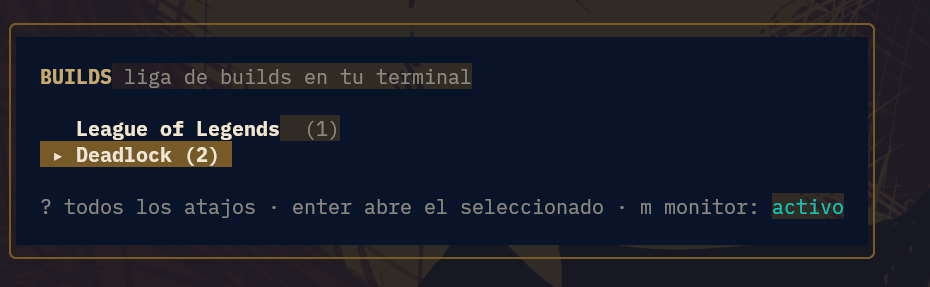

# MOBA TUI

```text
 __  __  ___  ____    _    _____ _   _ ___
|  \/  |/ _ \| __ )  / \  |_   _| | | |_ _|
| |\/| | | | |  _ \ / _ \   | | | | | || |
| |  | | |_| | |_) / ___ \  | | | |_| || |
|_|  |_|\___/|____/_/   \_\ |_|  \___/|___|
```

**Builds, runas y estadísticas de League of Legends y Deadlock — directo en tu terminal.**

[English README](README.en.md)

Una interfaz de terminal (TUI) rápida para **League of Legends** y **Deadlock** que convierte datos reales de partidas en builds, órdenes de habilidades y estadísticas fáciles de leer de un vistazo mientras juegas.

Desarrollada en Go con [Bubble Tea](https://github.com/charmbracelet/bubbletea) y [Lip Gloss](https://github.com/charmbracelet/lipgloss).

---

## Capturas de pantalla

### Vista de build e ítems (Deadlock)
> Tarjetas en truecolor por fase (`EARLY`, `MID`, `LATE`), evolución de componentes (`↑`), minuto estimado, costo en almas, orden de habilidades (`max 3 > 1 > 2 > 4`) y tendencia de win rate por parche.


### Selector de juego y lista de héroes

| Menú principal y monitor activo | Lista filtrable ordenada por Wilson Score |
| --- | --- |
|  |  |

---

## Características principales

- **Datos reales, sin humo:** Builds generadas a partir de secuencias de compra reales y evaluación estadística conservadora.
- **Confianza visible:** Etiquetas *alta / moderada / baja* según tamaño de muestra e incertidumbre, nunca presentadas como «probabilidad de ganar».
- **Arte en terminal (Truecolor):** Iconos de ítems y retratos de héroes/campeones renderizados directamente en consola.
- **Funciona offline:** Caché local en disco con TTL, degradación controlada (stale-if-error) y fallback a fixtures incluidos.
- **Monitor de partida (`m`):** Detecta automáticamente si el juego está abierto y, en League of Legends, identifica tu campeón en tiempo real mediante la *Live Client Data API*.

### Deadlock (vía [deadlock-api.com](https://deadlock-api.com))
- **Generador híbrido de builds:** Combina estadística por ítem con un motor de progresión que respeta cadenas de mejora, consumo de componentes y límites de inventario.
- **Fases y contexto:** Rutas divididas en **EARLY / MID / LATE**, extensiones para partidas largas e ítems **situacionales** agrupados por función (anti-heal, defensa física/espiritual, resistencia a CC, supervivencia y daño extra).
- **Habilidades reales:** Orden de subida mapeado a las teclas reales del héroe (`signature1..4`), consolidando formas transformadas en sus 4 ranuras reales.
- **Meta y enfrentamientos:** Tendencia de win rate entre parches, matchups y sinergias.

### League of Legends (vía [lolalytics.com](https://lolalytics.com))
- **Todo en un lugar:** Builds de objetos, páginas de runas, orden de habilidades y hechizos de invocador.
- **Ranking por cota inferior de Wilson:** Evita que muestras pequeñas con win rates inflados superen a builds probadas en decenas de miles de partidas.

---

## Requisitos e instalación

- **Go 1.27** o superior para compilar desde el código fuente.
- Una **terminal con soporte Truecolor** (Kitty, Alacritty, WezTerm, Ghostty, Windows Terminal, iTerm2, etc.) para visualizar correctamente los iconos y retratos.
- **Plataformas:** Linux es la plataforma principal; macOS y Windows están soportados en código y CI.

```bash
go install github.com/Eion21/mobatui@latest
mobatui
```

O compilando desde el repositorio:

```bash
git clone https://github.com/Eion21/mobatui
cd mobatui
go build -o mobatui .
./mobatui
```

La caché se guarda en el directorio de caché del usuario (por defecto `~/.cache/mobatui` en Linux) y la configuración en `~/.config/mobatui/config.json`. No se escriben archivos dentro del repositorio.

### Flags disponibles

| Flag | Por defecto | Descripción |
| --- | --- | --- |
| `-data` | `~/.cache/mobatui` | Directorio para la caché en tiempo de ejecución |
| `-offline` | `false` | Modo sin red: usa únicamente caché local y fixtures |
| `-refresh` | `false` | Invalida la caché estática antes de iniciar |
| `-locale` | `es_ES` | Idioma de Data Dragon para League of Legends |
| `-ugg` | `testdata/ugg` | Directorio de datos/dumps de u.gg |
| `-deadlock` | `testdata/deadlock/builds` | Directorio de fixtures/builds de Deadlock |

---

## Controles

| Tecla | Acción |
| --- | --- |
| `1` / `2`, `←` `→` | Seleccionar juego (`1` League of Legends, `2` Deadlock) |
| `g` | Cambiar de juego rápidamente |
| `enter` | Abrir héroe/campeón o abrir detalle del ítem seleccionado |
| `escribir` | Filtrar la lista de héroes/campeones en tiempo real |
| `tab` | Cambiar criterio de orden en la lista / cambiar pestaña en detalle |
| `1`-`4` / `1`-`5` | Saltar directamente a una pestaña (`Ítems`, `Resumen`, `Matchups`, `Habilidades`) |
| `←↑↓→`, `hjkl` | Mover selección entre tarjetas o filas |
| `r` / `R` | Forzar recarga (o rotar rol adelante/atrás en vista de detalle) |
| `u` | Plegar o desplegar tarjetas de mejora |
| `a` | Cambiar modo de retrato |
| `m` | Activar o desactivar el monitor de juego |
| `?` | Mostrar/ocultar ayuda de atajos |
| `esc` | Cerrar popup, limpiar filtro o volver atrás |
| `rueda del ratón` | Desplazar vista |

---

## ¿Cómo se calculan las builds?

El generador es deliberadamente conservador respecto a lo que afirma:

```text
┌──────────────┐      ┌──────────────┐      ┌──────────────────┐
│  APIs / HTML │ ───▶ │ Caché local  │ ───▶ │  Bubble Tea TUI  │
│  (red/fix)   │      │ TTL + stale  │      │ vistas + tarjetas│
└──────────────┘      └──────────────┘      └──────────────────┘
        │                     ▲                        │
        └──── fallback ───────┘                        ▼
                                   Selección → builds, skills, stats
```

1. **Ruta observada:** Secuencias de compra extraídas de partidas reales, ordenadas por precedencia de consenso.
2. **Evaluación estadística:** Cada ítem candidato se evalúa según popularidad, frecuencia ajustada por fase, rendimiento ajustado, tamaño muestral, incertidumbre estadística y consistencia (mediante distribución posterior Beta-Binomial y cota inferior de Wilson).
3. **Motor de progresión:** Valida que la secuencia sea mecánicamente comprable en partida (existencia de cadenas de mejora en el catálogo, consumo real de componentes, límite de ranuras de inventario y ausencia de ciclos).
4. **Build híbrida:** Combina el respaldo estadístico con la validez mecánica, registrando el motivo de inclusión o exclusión de cada objeto.

> **Nota sobre el Win Rate:** Un porcentaje de victoria alto **no** se interpreta como causalidad. Los ítems caros comprados cuando un equipo ya va ganando tienen win rates inflados; el sistema corrige este sesgo en lugar de premiarlo.

### Niveles de confianza

- **Alta:** Muestra grande, intervalo de incertidumbre estrecho y consistencia en los datos.
- **Moderada:** Datos utilizables, pero sin volumen suficiente para afirmaciones categóricas.
- **Baja:** Se muestra por completitud; debe tomarse solo como referencia.

---

## Limitaciones conocidas

- **Consenso estadístico, no juego óptimo:** Las builds reflejan qué funciona en el agregado de partidas, no una garantía de victoria en una partida concreta.
- **Cobertura de héroes en Deadlock:** El catálogo incluye 65 héroes; 44 cuentan con suficientes partidas en caché para generar rutas completas (el resto muestra estadísticas generales sin orden de compra, y 2 héroes en desarrollo aún no tienen kit publicado).
- **Etiquetas situacionales:** Se derivan de propiedades verificables del objeto (nombre y categoría), no de un análisis causal contra héroes específicos.
- **Dependencia de marcado en LoL:** Los datos de League of Legends se extraen del HTML renderizado de Lolalytics; cambios en su estructura web pueden requerir actualizar el parser.

---

## Desarrollo

```bash
go test ./...                    # Suite completa (sin conexión a internet)
go vet ./...                     # Análisis estático
gofmt -l .                       # Verificación de formato (debe salir vacío)
go run ./cmd/render deadlock     # Renderizado en texto plano para depurar layouts
```

### Estructura del proyecto

```text
.
├── cmd/
│   ├── mobatui/        # (o raíz con main.go) Punto de entrada principal
│   └── render/         # Renderizador de texto/fixtures para pruebas de layout
├── docs/
│   └── screenshots/    # Capturas usadas en el README
├── internal/
│   ├── deadlock/       # Cliente API, rutas, evaluación y generador híbrido
│   ├── progression/    # Catálogo, cadenas de mejora y simulación de inventario
│   ├── lolalytics/     # Cliente de estadísticas de LoL
│   ├── ddragon/        # Datos estáticos e imágenes de Data Dragon
│   ├── clean/          # Puntuación de Wilson y limpieza de builds
│   ├── ui/             # Vistas Bubble Tea, tarjetas y navegación
│   └── cache/          # Caché en disco (TTL, stale-if-error)
└── testdata/           # Fixtures para tests y modo offline
```

---

## Fuentes de datos y créditos

- **Deadlock:** [deadlock-api.com](https://deadlock-api.com) (API comunitaria). Los datos e imágenes pertenecen a Valve.
- **League of Legends:** [lolalytics.com](https://lolalytics.com) para estadísticas y [Data Dragon](https://developer.riotgames.com/docs/lol#data-dragon) para nombres e iconos.
- **Live Client Data API** (`127.0.0.1:2999`) para detectar el campeón activo en partida.

*Deadlock es una marca registrada de Valve Corporation. League of Legends y Riot Games son marcas registradas de Riot Games, Inc. Este proyecto no está afiliado, respaldado ni patrocinado por ninguna de las dos compañías.*

## Licencia

MIT — consulta el archivo [LICENSE](LICENSE). Los datos y recursos visuales de los juegos siguen siendo propiedad de sus respectivos dueños.
